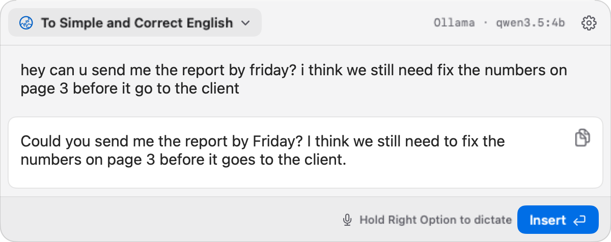

# Inklet

[English](README.md) | [简体中文](README.zh-CN.md) | [繁體中文](README.zh-TW.md) | [日本語](README.ja.md) | [한국어](README.ko.md) | [Español](README.es.md) | [Français](README.fr.md) | [Deutsch](README.de.md) | [Português](README.pt-BR.md) | [Italiano](README.it.md)

ホームページ：[getinklet.app](https://getinklet.app)

**Turn rough thoughts into clear text.**

<p align="center"></p>

<p align="center"><a href="https://github.com/wanming/Inklet/releases/latest/download/Inklet.dmg"><b>macOS 版をダウンロード</b></a> · 無料・オープンソース · macOS 14 以降</p>

- **どのアプリでも使える。** 入力中の場所で `Option+Space` を押し、結果をその場に挿入できます。
- **API キーは不要。** Apple シリコン搭載の Mac では、文章作成・翻訳・音声入力を内蔵モデルで Mac 上で実行し、ダウンロード後はオフラインでも使えます。
- **好きなモデルも使える。** OpenAI、Anthropic、Gemini、DeepSeek、Qwen などのキーを使うことも、Ollama や LM Studio に接続することもできます。
- **プライバシー重視。** アカウント不要、分析なし、Inklet のサーバーもありません。テキストは選んだモデルにだけ送られます。
- **あなたの言語で。** アプリと既定のプロンプトは 10 言語に対応しています。

**Inklet** は、入力・ペースト・音声で伝えた考えを、今使っているアプリから離れずに分かりやすい文章へ整える macOS の文章作成アシスタントです。

グローバルショートカットで文章作成ポップオーバーを開き、同じ編集可能な原文の下書きに入力・ペースト・音声入力できます。リアルタイム音声入力は文章作成アシスタントの中で完結するので、変換や挿入の前に書き起こしを確認できます。Apple シリコン搭載の Mac では、新規インストール時は音声をこの Mac 上で認識するため、声が Mac の外に出ることはありません。

> このドキュメントは英語版 [README.md](README.md) の翻訳です。内容に違いがある場合は英語版が優先されます。

## インストール

Inklet の公式な配布チャネルは GitHub Releases だけです。[GitHub Releases](https://github.com/wanming/Inklet/releases) から署名・公証済みの最新 DMG をダウンロードして開き、Inklet を `/Applications` にコピーしてください。

下のインストールスクリプトを使うこともできます。スクリプトは最新の GitHub Releases の DMG とチェックサムをダウンロードし、DMG の構造、チェックサム、Gatekeeper の受け入れ、バンドル ID、Hardened Runtime、実効 entitlements、アプリの署名を検証してから、Inklet を `/Applications` にコピーします。

```bash
curl -fsSL https://raw.githubusercontent.com/wanming/Inklet/main/scripts/install.sh | bash
```

## アップデート

Inklet のアップデート元は GitHub Releases だけです。製品版はおよそ 24 時間に一度、最新の安定版リリースの公開メタデータを GitHub から取得します。そのリリースに `Inklet.dmg` がアップロードされてから初めてアップデートが通知され、**GitHubで表示** を選ぶとそのリリースのページが開きます。通知で **インストールして再起動** を選ぶと、そのリリースをすぐにダウンロードしてインストールします。設定 › 一般の **アップデートを自動でインストール**（初期設定はオン）がオンなら、Inklet がこれを自動で行います。`Inklet.dmg` をバックグラウンドでダウンロードし、ディスクイメージが Gatekeeper の検査に通ること、中のアプリが実行中のアプリと同じ開発者の署名であることを確かめてから、Inklet を使っていないときにアプリを置き換えて再起動します。先に Inklet を終了した場合は、再び開かずにアップデートだけを適用します。Inklet が自分自身を置き換えられない場合（フォルダへの書き込み権限がないなど）や、ダウンロード・検証に失敗した場合は通知が表示され、適用できなかったアップデートが自動で再試行されることはありません。通知にはそのリリースノートがインターフェイスの言語で表示されます（翻訳がない場合は英語）。

製品版でも Inklet Local でも、アプリメニューの **アップデートを確認…** から手動で確認できます。Inklet Local は自動確認もアップデートのインストールも行いません。自動確認の失敗は通知されず、手動確認の失敗時には **再試行** が表示されます。文章作成、音声入力、選択アクション、データ移行、モーダル、開いているメニューなどで Inklet が使用中のときは、自動アップデートの通知やインストールはアプリが待機状態になるまで待ちます。

新機能をいち早く試したい場合は、設定 › 一般で **ベータ版のアップデート** をオンにします。オンにすると、Inklet は最新の安定版だけでなく最近の公開リリース一覧を読み取り、GitHub のプレリリースとして公開されたベータ版も知らせます。ベータ版ではバージョンの横に **Beta** と表示されます。オフにしても元のバージョンには戻らず、より新しい正式版が出るまで現在のベータ版のままです。

アップデート後に新しいバージョンを初めて起動すると、Inklet が待機状態のときに短い **新機能** ウインドウが一度だけ表示されます。使用中のアプリからフォーカスを奪うことはありません。新規インストール時やウェルカムガイドを開いている間は表示されません。メニューバーのメニューにある **更新履歴** にはすべてのリリースが一覧表示され、使用中のバージョンが強調表示されます。

## 初回セットアップ

1. 「アプリケーション」フォルダから Inklet を開きます。ソースからビルドする場合は、リポジトリのルートで `scripts/run-local-app.sh` を実行し、`/Applications/Inklet Local.app` を使います。
2. メニューバーの Inklet アイコンをクリックし、**設定** を開きます。
3. macOS に求められたらアクセシビリティの権限を許可します。Inklet はこの汎用的な権限ひとつで、選択テキストの読み取り、設定済みのコピーによる代替手段、直前のアプリへのフォーカスの復帰、確定した結果のペーストを行います。システム設定が開いている間 Inklet はバックグラウンドにとどまり、閉じると **一般** 設定に戻ります。
4. 新規インストール時と、このバージョンへのアップデート後に一度だけ、ウェルカムガイドが表示されます。インターフェイスの言語（新規インストールではシステムの言語に従います）、アクセシビリティ、文章作成モデル、リアルタイム音声入力のマイク、Inklet を開くショートカットと音声入力のショートカットを順に設定し、最後にテキストを選択すると現れるバーを紹介します。もう一度見たいときは、メニューバーのメニューから**ようこそガイド**を選びます。各ステップは現在の設定から始まります。Apple シリコン搭載の Mac では **内蔵** と推奨モデルが提案され、そのまま選ぶとバックグラウンドでダウンロードされます。文章作成ポップオーバーに進行状況が表示され、完了後はオフラインでも使えます。クラウドのプロバイダを使う場合は、**AI モデル** でプロバイダを選び、その API キーを入力します。Intel Mac の初期設定である OpenAI なら、1 つのキーで文章作成、リアルタイム音声入力、選択テキストの翻訳、発音をまかなえます。ほかのプロバイダを選んだ場合、文章作成と選択テキストの翻訳はそのプロバイダを使いますが、音声入力と発音で OpenAI を選んだ場合は、同じページの「API キー」欄に OpenAI API キーが必要です。キーなしで文章作成と翻訳を Mac 上で動かしたい場合は **内蔵** を選んでモデルをダウンロードするか、すでに使っていれば **Ollama** または **LM Studio** を選びます（[ローカルモデル](#ローカルモデル) を参照）。最後のステップでは**ログイン時に Inklet を開く**も選べます（初期設定はオフ）。あとから設定 › 一般の**ログイン時に開く**でいつでも変更でき、macOS のシステム設定 › 一般 › ログイン項目にも Inklet が表示されます。
5. **文章作成アシスタント** で、モデル、文章作成のショートカット、生成設定、Prompt モードを設定します。**リアルタイム音声入力** には専用の設定ページがあり、オン／オフ、音声認識に **この Mac** と **OpenAI** のどちらを使うか、長押しショートカット、マイクを選べます。Apple シリコン搭載の Mac の新規インストールでは **この Mac** が使われ、ウェルカムガイドで音声入力をオンにすると音声モデルがダウンロードされます。既存の設定は、切り替えるまで OpenAI のままです。OpenAI を使う場合、**音声入力の詳細設定** で変更できるのはリカバリ用モデルだけで、リカバリ用エンドポイントは編集できません。リアルタイムモデルは Inklet が固定しています。
6. 任意：**選択アシスタント** で翻訳先の言語、**強制選択** モード、AI 発音の声と速度を設定し、設定画面で声を試聴できます。
7. 音声入力ショートカットを初めて有効に長押ししたときに、マイクの権限を許可します。Inklet を開いたり、設定を表示したり、原文エディタの外でショートカットを押したりしただけでは、権限は求められません。

## 日常の使い方

テキストの流れ：

1. ほかのアプリでテキストフィールドにフォーカスを置きます。
2. `Option+Space` を押します。
3. Prompt モードをあいまい検索し（たとえば `英語` で `シンプルで正しい英語に` が見つかります）、`↑` / `↓` で選んで `Tab` または `Enter` で確定します。
4. 下書きを入力またはペーストします。
5. `Enter` で変換します。結果は生成されながら表示され、`Escape` で止められます。
6. もう一度 `Enter` を押すと結果を挿入します。挿入せずにコピーするには `Shift+Command+C` を押すか、結果のコピーボタンをクリックします。

音声入力の流れ：

1. `Option+Space` で **文章作成アシスタントを開きます**。
2. **Prompt モードを確定します**。モード選択画面と結果エディタでは音声入力できません。
3. **原文の下書きにカーソルを置くか、置き換えたいテキストを選択します。** 音声入力はカーソル位置に挿入されるか、選択範囲を置き換えます。
4. **設定した音声入力ショートカットを長押しし**（初期設定は右 Option）、普段どおりに話すと、下書きがその場で更新されます。短く押しても何も起きません。リアルタイム接続が切れても、そのまま押し続けて話してください。Inklet が一時的なリカバリ用録音をひとつ保持します。
5. **離すと書き起こしが確定します**。**この Mac** を使う場合、リカバリも Mac 上で書き起こされます。OpenAI を使う場合、リカバリが必要になると、Inklet はリアルタイム音声入力と同じ既存の OpenAI API キーで `https://api.openai.com/v1/audio/transcriptions` にリクエストを 1 回だけ送ります。一時録音は代替リクエストが実際に始まるまでローカルにとどまり、アップロードは最大 1 回で、セッション終了時に削除されます。
6. 音声入力した下書きを確認・編集します。音声入力だけでは Prompt モードは実行されず、ほかのアプリにテキストが挿入されることもありません。
7. **準備ができたら Return を押して** 確定した Prompt モードを実行します。結果を挿入したいときだけ、もう一度 Return を押します。

音声入力ショートカットは原文エディタ内でのみ有効で、長押し専用です。修飾キーは **設定** → **リアルタイム音声入力** で右 Command、左 Option、左 Command に変更するか、音声入力そのものをオフにできます。Escape、フォーカスの喪失、ポップオーバーを閉じる、別の原文セッションを開く、のいずれかで音声入力はキャンセルされ、元の下書きに戻ります。

## できること

- macOS のグローバルホットキーで開きます。初期設定は `Option+Space` です。
- 文章作成アシスタントの原文エディタがアクティブな間、修飾キーのショートカットを押し続けると、リアルタイム音声入力が下書きに流し込まれます。初期設定は右 Option です。
- ほかの Mac アプリでテキストを選択して少し待つと選択アクションが表示されます。EasyDict 風の選択テキスト読み取り、クイック翻訳、カスタマイズ可能な **翻訳** プロンプト、AI 発音を備え、翻訳結果ウインドウはサイズ変更でき、最後のサイズを記憶します。繰り返しの翻訳は 7 日間ローカルにキャッシュされます。
- 選択バーや翻訳結果が邪魔なときは、好きな場所へドラッグできます。クリックはそのまま使え、次に選択したときはまたテキストの近くに表示されます。
- 1,500 文字を超える選択テキストは、ページ全体を誤って選んだときに反応しないよう無視します。
- 選択テキストをそのまま読み上げられるほか、翻訳結果から原文と訳文の両方を再生できます。
- **設定** › **選択アシスタント** › **メニューボタン** で、選択メニューに表示するボタンとその順序を選べます。**翻訳**、**発音**、任意の Prompt モードをボタンにでき、同時に表示されるのは最大 4 つで、残りは **その他** にまとまります。Prompt モードのボタンは選択テキストにそのモードを実行し、結果をコピー・再生ボタン付きのパネルに表示します。
- 組み込みの Prompt モードでテキストを変換します：
  - To Simple and Correct English（書く言語に書き換えます。設定 › 一般で選べ、既定は英語）
  - Summarize（翻訳先言語で要約。既定ではインターフェース言語に従います）
  - To Japanese など（翻訳先言語に翻訳。単語ひとつなら意味、発音、例文を表示）
  - Voice Cleanup
  - 内蔵モードの名前はどのインターフェース言語でも英語のままなので、同じ文字で検索できます。名前を変えるまでは、設定した言語名が入ります。
- 結果は生成されながらポップオーバーに表示され、その後、直前にフォーカスしていたアプリへ挿入するか、結果のコピーボタンでコピーできます。
- アプリに依存しない、アクセシビリティ優先の選択テキスト読み取り経路をひとつだけ使います。自動の選択アクションはまず macOS のアクセシビリティに選択内容を問い合わせ、**強制選択** が許可している場合に限り、設定済みの一時的なクリップボードによる代替手段を使います。各読み取りは取得したソースプロセスに結び付けられ、そのプロセスが終了するかフォーカスを失うとキャンセルされます。
- `Command+C` のシミュレーションは初期設定でオフです。メニューからのコピーが安全な **強制選択** の代替手段であり続けます。使えるコピーメニューがないアプリ向けに、高度な代替手段としてコピーのシミュレーションを明示的に有効にできますが、ゲーム、リモートデスクトップ、仮想マシンの動作に干渉する場合があります。
- 一時的なクリップボードの読み取りは 1 つずつ順番に行われ、同じ読み取りが観測したコピー結果をまだ保持している場合にのみ、以前のスナップショットを復元します。より新しいクリップボードの内容が優先されます。ダブルコピーによる起動は受動的で、ユーザーがすでに行ったコピーを読み取るだけで、追加の疑似コピーや古いクリップボードデータの復元は行いません。右クリックはネイティブのままで、選択テキストの読み取りを始めることはありません。
- ブラウザ専用の選択テキスト読み取りコードは使わず、ブラウザのオートメーション権限も求めません。Chrome、Safari、Edge、ネイティブアプリは同じ汎用経路を使います。
- Prompt モード、プロバイダ、モデル、カスタムの OpenAI 互換エンドポイント、タイムアウト、文章作成のショートカット、音声入力の長押しショートカット、マイク、リカバリ用モデル、選択テキストの翻訳先言語、選択時の **翻訳** プロンプト、選択メニューのボタン、**強制選択** モード、コピーのシミュレーションの許可、AI 発音の声と速度を編集できます。
- 成功した文章作成と選択アクションの結果をローカルの **履歴** に表示します。連続する重複は 1 つにまとめられ、原文と結果のテキストは選択でき、結果のコピーとすべて消去の操作があります。以前の Voice 項目も引き続き読めます。
- 文章作成と翻訳には、OpenAI、Anthropic、Google Gemini、DeepSeek、Alibaba Qwen、Moonshot Kimi、Zhipu GLM、MiniMax、SiliconFlow、Volcengine Ark、Tencent Hunyuan、Baichuan、01.AI Yi、xAI、Groq、Mistral、OpenRouter、Perplexity、Together AI、Cerebras、またはローカルのモデルサーバなど任意のカスタム OpenAI 互換エンドポイントを使えます。発音は AI モデルの「テキストから音声」で選んだエンジン（macOS のシステム音声。新規インストールの既定で、オフラインかつ無料。または OpenAI）を使い、音声入力は **リアルタイム音声入力** で選んだ音声認識エンジンを使います。
- 内蔵エンジン（Qwen3.5 4B または Gemma 4 E4B、Hugging Face から一度だけダウンロード）や、ローカルの Ollama・LM Studio サーバを使って、文章作成と翻訳を Mac 上で実行できます。API キーは不要で、テキストは Mac の外に出ません。
- アプリの UI は英語、簡体字中国語、繁体字中国語、日本語、韓国語、スペイン語、フランス語、ドイツ語、ポルトガル語、イタリア語に対応しています。
- コンパクトな選択メニューや、設定・文章作成画面の限られたスペースのコントロールは、翻訳後のラベルに合わせてレイアウトを調整します。言語を切り替えると、文章の内容を保ったまま開いている UI が更新されます。

## 現在の状況

Inklet は初期段階の MVP です。リポジトリには現在、次のものが含まれています：

- macOS アプリとコアの文章作成エンジンの Swift Package。
- 文章作成ポップオーバーと設定ウインドウを持つメニューバーアプリ。
- プロバイダのアダプタと設定の保存。
- コアの動作のユニットテスト。
- 手動テストのメモ：[docs/manual-test-checklist.md](docs/manual-test-checklist.md)。

## 動作環境

- macOS 14 以降。
- Swift 6 ツールチェーン。
- XCTest を使うため、完全な Xcode を推奨します。
- Inklet のアクセシビリティ権限。汎用的な選択テキストの読み取り、設定済みのコピーによる代替手段、直前のアプリへのフォーカスの復帰、生成結果のペーストに必要です。
- ショートカットを押している間のリアルタイム音声入力のためのマイク権限。
- OpenAI またはほかの対応プロバイダの API キー、またはローカルモデル。発音と音声入力に OpenAI API キーが必要なのは、OpenAI を選んだ場合だけです。

## ローカルモデル

Inklet は Mac 上で動くモデルで文章作成と翻訳ができます。テキストは Mac の外に出ず、API キーも不要です。

- **内蔵**（Apple シリコンのみ。新規インストールの初期設定）：プロバイダで **内蔵** を選び、モデルを選んで **ダウンロード** をクリックします。メモリ 16 GB 以上の Mac では Gemma 4 E4B（約 4.6 GB）が初期設定で、8 GB の Mac には Qwen3.5 4B（約 2.7 GB）がおすすめです。新規インストールではウェルカムガイドがダウンロードし、ダウンロード中は文章作成ポップオーバーに進行状況が表示されます。モデルがまだない場合はポップオーバーに **ダウンロード** ボタンが出ます。ダウンロードは中断しても再開でき、使用前に固定の SHA-256 で検証されます。**内蔵** を選んだ状態で文章作成ポップオーバーを開くと、Inklet は同梱の llama.cpp サーバをループバックアドレスだけで起動してモデルを読み込むので、送信するころには準備ができていることがほとんどです。メモリ 24 GB 以上の Mac ではモデルは読み込まれたままで、macOS のメモリが不足したときだけ解放されます。それより小さい Mac では、5 分間使わないとサーバがモデルを解放します。
- **この Mac での音声入力**（Apple シリコンのみ。新規インストールの初期設定）：リアルタイム音声入力は Qwen3-ASR 0.6B（約 1 GB）で音声を認識します。30 言語と、英語交じりの中国語に対応しています。同じ同梱の llama.cpp エンジンを別のサーバで動かし、話している間はおよそ 0.6 秒ごとに書き起こし直し、間を置いたところで文を確定します。メモリ 16 GB 以上の Mac では、音声入力がオンの間は音声モデルを読み込んだままにします。それより小さい Mac では文章作成ポップオーバーを開いたときに読み込み、5 分間使わないと解放します。音声入力をオフにするか OpenAI を選ぶと停止します。Inklet または macOS が繁体字中国語を使っている場合、中国語の音声入力は繁体字で書き出されます。
- **Ollama**：[Ollama](https://ollama.com) をインストールし、`ollama pull qwen3.5:4b` を実行してから **Ollama** を選びます。Inklet は Ollama がダウンロード済みのモデルを一覧表示します。
- **LM Studio**：LM Studio のローカルサーバをポート 1234 で起動してモデルを読み込み、**LM Studio** を選びます。

ローカルのプロバイダには、最初のリクエストでモデルを読み込めるよう、1 リクエストあたり最低 120 秒が与えられます。Inklet はローカルサーバに「思考」を省くよう求めるので、小さな推論モデルもすぐに答えを返します。ソースからのビルドでは `scripts/build-llama-server.sh` で内蔵エンジンをコンパイルし、`cmake` が必要です。ない場合でもアプリは動作し、**内蔵** の項目でエンジンが含まれていないことが説明されます。

## ビルドと実行

アプリバンドルをビルドするたびに、ルートの `VERSION` ファイルにある `INKLET_VERSION` と `INKLET_BUILD_NUMBER` の両方を上げてください。通常はパッチバージョンを上げ、大きな変更ではマイナーまたはメジャーバージョンを上げます。ビルド番号は、マーケティングバージョンが変わっても、これまでに使ったどのビルド番号よりも大きい正の整数でなければなりません。番号を決める前に、最新の `main`、Git タグ、すべての GitHub リリース（下書きを含む）、作業中の worktree を確認してください。Inklet はこのビルド番号だけで、アップデートが新しいかどうかを判断します。

GitHub でのリモート DMG ビルドは `main` からのみ行います。予定の変更と更新した `VERSION` をマージして `main` にプッシュしてから、`--ref main` で `build-dmg.yml` を実行します。

正式リリースでは、ビルドの成功と最終的な成果物を確認し、仮の説明を前回の公開安定版以降の中国語と英語の変更内容に置き換えてから、最新の安定版として公開します。検証済みの下書きは、再ビルドやバージョン変更なしで公開できます。

DMG ワークフローはビルド前に、再利用された番号や小さいビルド番号を検出して拒否しますが、どちらの値も自動では上げません。手動での確認方法は [release version checks](scripts/README.md#release-version-checks) を参照してください。パッケージ済みアプリのバージョンを変えるには、再ビルド、署名、公証、チェックサムの再生成が必要です。リリースのタイトルやファイル名を変えるだけでは、アプリは更新されません。

リポジトリのルートで：

```bash
swift build
scripts/run-local-app.sh
```

日常の手動テストには、どの worktree からでも `scripts/run-local-app.sh` を使ってください。固定の `/Applications/Inklet Local.app` としてインストールして開くので、macOS のアクセシビリティやキーチェーンの許可を再ビルド後も使い回せます。

テストの実行：

```bash
swift test
```

`XCTest` が使えずテストが失敗する場合は、Command Line Tools だけでなく、完全な Xcode アプリをインストールしてください。

すべての UI 言語は `scripts/check-localization.sh` で確認できます。`--snapshots` を付けると、合成データによるネイティブ UI の HTML ギャラリーが `.build/localization-audit/` に生成され、そのパスが表示されます。プルリクエストと `main` へのプッシュでは、ユニットテスト一式とローカライズのチェックが自動で実行されます。対象範囲と、手動で確認すべき残りの項目は [localization audit](docs/localization-audit.md) を参照してください。

## キーボード操作

- `Option+Space`：文章作成ポップオーバーを開きます。
- `Right Option`：文章作成アシスタントの原文エディタがアクティブなときに長押しで音声入力します。修飾キーの変更や音声入力のオフは **設定** → **リアルタイム音声入力** で行えます。短く押しても何も起きません。
- モードランチャーで `Up` / `Down`：あいまい検索の順位で並んだ Prompt モード間で選択を移動します。
- モードランチャーで `Tab`、`Return`、テンキーの `Enter`：選択中の Prompt モードを確定し、原文エディタにフォーカスします。日本語入力などの変換中は、Return は文字や候補の確定に使われます。Command、Shift、Option、Control と組み合わせた Return ではモードは確定しません。
- エディタで `Enter`：原文を変換する、現在のモードで生成した結果を挿入する、または以前のモードで生成された古い結果を新しく確定したモードで再生成します。
- `Command+Enter`：モデルを呼び出さずに原文をそのまま挿入します。
- `Shift+Command+C`：ポップオーバーを閉じずに表示中の結果をコピーします。
- `Command+Up` / `Command+Down`：表示中の Prompt モードを順に切り替えます。
- `Command` だけを押し続ける：下部バーにすべてのショートカットを表示します。通常、バーには音声入力のヒントとメインボタンだけが表示されます。ショートカットはどちらの状態でも使えます。
- `Escape`：押すたびに 1 段階戻ります。結果から原文エディタ、モードランチャーへ戻り、最後にポップオーバーを閉じます。変換中に押すと生成を止め、途中の結果を破棄してエディタにとどまります。
- `Command+,`：Inklet がアクティブなときに設定を開きます。

検索は大文字小文字と発音区別符号を区別せず、文字の順序どおりのマッチングに対応します。完全一致と前方一致が最も強く優先され、連続した一致、単語の先頭、より前方、より間隔の狭い一致が一般的に上位になります。

モードランチャーを開くと、最後に確定した Prompt モードがまだ表示されていればそれが選択された状態になります。シングルクリックでモードを選択し、ダブルクリックで確定します。ランチャーに戻っても、現在の下書きと結果は保たれます。

## リポジトリの構成

```text
Sources/InkletApp/       macOS app, popover UI, settings UI, menu bar coordination
Sources/InkletCore/      core config, providers, prompts, hotkeys, insertion, state machine
Tests/InkletCoreTests/   unit tests for core behavior
docs/                    手動 QA とプライバシーポリシー
```

## 開発メモ

- プロバイダの動作は、焦点を絞ったユニットテストでカバーしてください。
- ユーザーに見えるアプリの変更をリリースする前に、[docs/manual-test-checklist.md](docs/manual-test-checklist.md) を使ってください。
- 日常のアプリの手動テストには、SwiftPM の実行ファイルや `open dist/...` ではなく `scripts/run-local-app.sh` を使ってください。ローカルのアクセシビリティとキーチェーンの許可が、固定されたひとつのアプリに結び付いたままになります。
- クリップボードとアクセシビリティの流れはアプリ体験の中心なので、慎重に扱ってください。
- プロジェクトはまだ MVP 段階なので、README は今後の計画ではなくコードの現状に合わせてください。

## ローカルの保存先とアップグレード

製品版とローカル QA 版はバンドル ID ごとに分けた保存先を使い、設定、履歴、翻訳キャッシュ、診断情報、キーチェーンの認証情報を共有しません：

- 製品版の Application Support：`~/Library/Application Support/com.tomwan.inklet/`
- ローカル版の Application Support：`~/Library/Application Support/com.tomwan.inklet.local/`
- 製品版の環境設定：`~/Library/Preferences/com.tomwan.inklet.plist`
- ローカル版の環境設定：`~/Library/Preferences/com.tomwan.inklet.local.plist`
- プロバイダの API キー：対応する Application Support フォルダ内の `api-keys.json`。あなたのユーザーアカウントだけが読み取れ、Time Machine のバックアップから除外されます
- 以前のバージョンが使っていたキーチェーンのサービス：`Inklet.ProviderAPIKey`（製品版）と `Inklet.Local.ProviderAPIKey`（ローカル版）

以前のバージョンは API キーをキーチェーンに保存していました。キーが初めて必要になったとき、Inklet はそれをキーチェーンから `api-keys.json` にコピーし、キーチェーンの項目はそのまま残すので、以前のバージョンに戻してもキーが見つかります。設定でキーを変更または消去すると、キーチェーンのコピーも削除されます。

以前のサンドボックス版からアップグレードして初めて起動すると、Inklet は認識できた以前の環境設定、プロバイダの API キー（対応するキーチェーンのサービスへ）、履歴を、現在のバンドルの保存先へ自動でコピーします。移行元の削除や変更は行わないため、以前のデータはロールバックや復旧のために残ります。破棄してよい翻訳キャッシュは移行されません。

macOS が対応する以前のコンテナへの自動アクセスをブロックした場合、設定には **旧データをインポート…** の操作が常に用意されます。この補助インポートは、実行中の製品版またはローカル版に対応する正確な以前の `Data` フォルダだけを受け付け、現在のファイルパネルの許可が有効な間だけ読み取り、永続的なアクセス用ブックマークは保存しません。

## プライバシー

- Inklet は、文章作成と選択テキストの翻訳のリクエストを、設定で選んだプロバイダにそのプロバイダの API キーで送ります。macOS のシステム音声では発音は Mac 上で読み上げられ、テキストから音声に OpenAI を選んだ場合だけ、あなたの OpenAI API キーで OpenAI を使います。音声入力が OpenAI を使うのは、音声認識エンジンとして OpenAI を選んだ場合だけです。
- 音声認識に **この Mac** を使う場合、音声入力の音声とリカバリ用録音は Mac 上のサーバで処理され、Mac の外に出ることはありません。
- 音声認識に OpenAI を使う場合、音声入力ショートカットを押している間、マイクの音声は OpenAI Realtime の書き起こしへ直接ストリーミングされます。Inklet はさらに一時的なローカルのリカバリ用録音をひとつ保持します。これは代替リクエストが実際に始まるまでローカルにとどまり、リアルタイム音声入力と同じ既存の OpenAI API キーで `https://api.openai.com/v1/audio/transcriptions` へ最大 1 回だけアップロードされ、セッションがどのように終了しても削除されます。
- API キーはプロバイダごとに、あなたの Mac 上に保存されます。
- **内蔵**、Ollama、LM Studio を使う場合、文章作成と翻訳のリクエストは Mac 上のサーバにだけ送られます。内蔵モデルのダウンロードでは、選んだファイルを Hugging Face に 1 回リクエストします。このリクエストにあなたのテキスト、音声、API キー、設定は含まれません。
- Inklet はアクセシビリティ権限を、汎用的な選択テキストの読み取り、設定済みのコピーによる代替手段、直前のアプリへのフォーカスの復帰、テキストのペーストに使います。
- Inklet がマイク権限を使うのは、文章作成アシスタントの原文エディタがアクティブな状態での有効な音声入力の長押し中だけです。音声入力が終わると編集可能な下書きが残り、ほかのアプリには挿入されません。
- Inklet は、挿入と、設定済みの **強制選択** による代替の読み取りのために、クリップボードを一時的に使います。**強制選択** の読み取りは、Inklet が一時的にコピーした内容がまだ最新である場合にのみ以前のクリップボードを復元し、その後の外部でのクリップボードの変更を上書きしません。
- Inklet は、成功した文章作成と選択アクションの原文と結果を、設定で消去するまでローカルの履歴に保存します。連続する重複は保存しません。未処理の音声入力の下書きは履歴を作りません。以前の Voice 項目はローカルで引き続き読めます。
- 選択アクションは、ソースアプリと選択位置を取得し、読み取りの前と最中にそのソースを検証して、アクセシビリティで現在の選択内容を読み取ります。アクセシビリティが選択テキストを返さない場合、設定済みの **強制選択** モードがメニューの「コピー」を一時的に実行し、上で説明した保護された手順でクリップボードのテキストを読み取ることがあります。`Command+C` のシミュレーションは初期設定でオフで、高度なオプトインを明示的に有効にした後にだけ実行されます。**強制選択** は設定でオフにできます。この経路はブラウザ向けの Apple Events を送らず、ブラウザのオートメーション権限も求めません。テキストを選択した後に `Command+C` をすばやく 2 回押すと、あなたが行ったコピーを明示的に読み取ります。単に選択しただけのテキストは保存されず、成功したアクションがローカルの履歴に記録された場合だけ保存されます。
- 選択アシスタントは、成功した翻訳結果をハッシュ化したキャッシュキーで 7 日間ローカルにキャッシュし、繰り返しの翻訳を速くします。
- ローカルのキャッシュがない場合、選択アシスタントの翻訳は、選択テキストとカスタムの **翻訳** の指示を選んだプロバイダに送ります。Prompt モードのボタンは、選択テキストとそのモードのプロンプトを選んだプロバイダに送ります。発音が選択テキストを OpenAI に送るのは、テキストから音声のエンジンが OpenAI の場合だけです。
- Inklet は `models.dev` から公開のモデルカタログを 1 日に最大 1 回取得します。このリクエストにあなたのテキスト、音声、API キー、アプリの設定は含まれません。
- OpenAI や選んだプロバイダのデータの扱いを信頼できない場合は、プライベートなテキストや音声を送らないでください。

## フィードバック

Inklet のメニューバーのメニューから **フィードバックを送信…** を選ぶか、[issue を作成](https://github.com/wanming/Inklet/issues/new/choose)してください。不具合の報告や機能のアイデアを歓迎します。issue に API キーやプライベートなテキストは絶対に貼り付けないでください。

## コントリビュート

[CONTRIBUTING.md](CONTRIBUTING.md) を参照してください。

## セキュリティ

脆弱性の報告と機密データの取り扱いについては [SECURITY.md](SECURITY.md) を参照してください。

## ライセンス

Inklet は [MIT License](LICENSE) で公開されています。
サードパーティのライセンス表記は [THIRD_PARTY_NOTICES.md](THIRD_PARTY_NOTICES.md) にあります。
